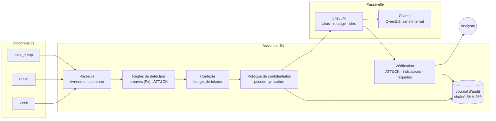

# Assistant LLM pour l'analyse forensique avec nix-forensics

**Un assistant d'analyse forensique, écrit en Python, qui lit les sorties des outils de [nix-forensics](https://github.com/airbus-cert/nix-forensics), détecte les traces d'attaque avec des règles classées MITRE ATT&CK, puis s'appuie sur un modèle de langage exécuté en local pour produire un rapport d'incident vérifié, répondre aux questions de l'analyste et générer des requêtes de chasse.**


> 🇬🇧 *English summary at the [end of this page](#english-summary).*

nix-forensics fournit, dans des versions figées par Nix, les outils qui extraient les traces d'une machine (journaux Windows, registre, système de fichiers, réseau). Ces outils ne les interprètent pas : un journal `Security.evtx` donne des dizaines de milliers de lignes à relire. L'assistant ajoute cette étape d'interprétation sans faire sortir les données d'enquête, sans laisser le modèle affirmer un fait absent des artefacts, et en gardant chaque appel au modèle traçable et rejouable. Son apport est **mesuré** sur 22 scénarios annotés, dont 18 enregistrements d'attaques réelles, en le comparant aux règles seules.

---

## Travail réalisé

- **Lecture des artefacts** : parseurs pour `evtx_dump` (JSONL ou `.evtx`), auth.log, bodyfile, Plaso `l2tcsv` et Zeek, ramenés à un format d'événement commun.
- **Détection** : 14 règles déterministes (force brute, spray Kerberos, création de compte, persistance par service, dump d'identifiants, PowerShell, effacement de journaux, balisage C2, tunnel DNS…), chacune rattachée à ses techniques ATT&CK.
- **Analyse par LLM** : passerelle LiteLLM devant des modèles Qwen2.5 servis par Ollama, contexte réduit sous un budget de tokens, prompts versionnés, sortie JSON contrainte par schéma.
- **Vérification** : techniques contrôlées dans le catalogue ATT&CK, indicateurs recherchés dans les artefacts bruts, requêtes Sigma et jq validées puis exécutées.
- **Confidentialité** : modèles locaux par défaut, modèle cloud uniquement sur option explicite après pseudonymisation réversible, Ollama sans accès à Internet.
- **Traçabilité** : journal d'audit chaîné par SHA-256, vérification d'intégrité et rejeu des appels au modèle.
- **Déploiement** : Docker Compose, manifestes Kubernetes (profil air-gapped et profil hybride, NetworkPolicies en default-deny), paquet et overlay Nix.
- **Évaluation** : banc comparant chaque modèle aux règles seules (verdict, ATT&CK, indicateurs, questions, fuites, latence), exécuté sur GPU Tesla T4 ; 42 tests et intégration continue GitHub Actions.

## Ce que fait l'assistant

| Composant | Module | Points clés |
|---|---|---|
| **Parseurs** | `parsers/` | formats de nix-forensics et outils courants (`evtx_dump`, Plaso, Zeek, auth.log, bodyfile), normalisation vers un événement commun, conversion `.evtx` sans `evtx_dump` via la bibliothèque `evtx` |
| **Règles de détection** | `detect/rules.py` | 14 règles, gravité de LOW à CRITICAL, techniques **ATT&CK**, décodage du PowerShell encodé, chaque détection devient une preuve numérotée `[F1]`, `[F2]`… |
| **Contexte** | `context.py` | des milliers d'événements réduits sous un **budget de tokens** : statistiques, preuves (au plus 60 % du budget), chronologie des événements notables |
| **Confidentialité** | `privacy.py`, `llm.py` | politique appliquée **avant tout envoi**, pseudonymisation réversible des hôtes, comptes et IP (`HOST_1`, `USER_2`, `IP_PUB_3`), `--show-prompt` pour voir ce qui part |
| **Analyse** | `assistant.py`, `prompts.py` | `summarize` (rapport d'incident), `ask` (question de l'analyste), `query` (requête Sigma, KQL, SPL, EQL, jq ou Zeek), critères de verdict liés à la gravité des preuves |
| **Vérification** | `assistant.py` | schéma JSON avec un tour de réparation, identifiants ATT&CK vérifiés, indicateurs non retrouvés signalés, requêtes validées et exécutées sur les preuves |
| **Audit** | `audit.py` | journal JSONL **chaîné par hash** : empreinte des artefacts, requête exacte, modèle demandé et servi, paramètres, réponse ; `dfa audit verify` et `dfa audit replay` |
| **Interfaces** | `cli.py`, `tui.py` | commande `dfa` et interface terminal **Textual** |
| **Évaluation** | `eval/harness.py` | comparaison modèle contre règles seules, score de verdict exact et « danger vu », rapports Markdown |

## Architecture



Le modèle ne remplace pas la détection : il reçoit les preuves des règles et produit la synthèse, la corrélation et les réponses. Exemple sur le scénario `samples/win-rdp-intrusion` (126 événements Windows), où `dfa triage` trouve en moins d'une seconde :

| Gravité | Preuve | ATT&CK |
|---|---|---|
| critical | 45 échecs RDP depuis 203.0.113.45, puis connexion réussie en `administrator` | T1110.001, T1078, T1021.001 |
| medium | Reconnaissance : `whoami /all`, `net user`, `nltest /dclist` | T1033, T1087, T1482 |
| high | Compte `svc_backup` créé et ajouté aux Administrateurs | T1136.001, T1098 |
| high | PowerShell encodé qui télécharge `http://198.51.100.77/a.ps1` | T1027, T1059.001, T1105 |
| high | Service `WinUpdateHelper` qui lance ce PowerShell caché | T1543.003 |
| high | Journal Security effacé | T1070.001 |

`dfa summarize` transmet ces preuves au modèle et rend un rapport structuré (résumé, verdict, chronologie, techniques justifiées par une preuve, indicateurs, actions recommandées), vérifié avant affichage.

## Évaluation

| Jeu | Contenu | Rôle |
|---|---|---|
| `eval/scenarios` | 4 scénarios synthétiques : intrusion RDP, compromission SSH, C2 et exfiltration DNS, journée normale | valider la chaîne, mesurer les fausses alertes |
| `eval/public` | 8 enregistrements [EVTX-ATTACK-SAMPLES](https://github.com/sbousseaden/EVTX-ATTACK-SAMPLES) | mise au point |
| `eval/holdout` | 10 autres enregistrements, jamais utilisés pour écrire une règle | mesure de la généralisation |

Verdicts justes sur le jeu public (Qwen2.5 sur Tesla T4, température 0, graine fixe) :

| Essai | Changement | Règles seules | Qwen2.5 14B | Qwen2.5 7B |
|---|---|---|---|---|
| 1 | — | 62 % | 12 % | 25 % |
| 2 | Critères de verdict liés à la gravité des preuves | 62 % | 62 % | 62 % |
| 3 | Règles spray Kerberos, PowerShell, faux compte machine, service lancé par un interpréteur | 100 % | 100 % | 100 % |

- Les modèles repéraient les attaques mais concluaient « suspicious » : les critères de verdict ont corrigé l'étalonnage sans changer de modèle.
Sur les 10 enregistrements jamais vus (`holdout`, essai 4) :

| | Règles seules | Qwen2.5 14B | Qwen2.5 7B |
|---|---|---|---|
| Verdicts justes | 20 % | 20 % | 20 % |
| Attaques repérées (danger vu) | 40 % | **80 %** | 70 % |
| F1 ATT&CK moyen | 0.20 | 0.20 | 0.20 |

- Les règles écrites à la main généralisent mal : 100 % sur le jeu de mise au point, 20 % sur le jeu `holdout`.
- Sur ces attaques inconnues des règles, le modèle **double la part d'attaques repérées** (DCSync, regsvr32, wmiexec, porte dérobée d'accessibilité), mais les classe `suspicious` et ne cite pas la bonne technique ATT&CK.
- Les modèles répondent mieux que les règles aux questions de l'analyste (75 % contre 62 %), sans aucune fuite de donnée.
- Deux sessions GPU distinctes ont donné des réponses identiques au token près.

Détail de chaque essai : [`docs/results/`](docs/results/).

## Démarrage rapide

Python 3.11 ou plus.

```bash
git clone https://github.com/daren-houedanou/dfir-llm-assistant.git
cd dfir-llm-assistant
pip install -e '.[tui]'

dfa triage samples/win-rdp-intrusion        # règles seules, sans modèle
pytest                                      # 42 tests
```

### Avec les modèles locaux

```bash
cp deploy/.env.example deploy/.env          # renseigner LITELLM_MASTER_KEY
docker compose -f deploy/docker-compose.yml up -d
export DFA_API_KEY=sk-change-me             # même valeur que LITELLM_MASTER_KEY

dfa summarize samples/win-rdp-intrusion
dfa ask samples/linux-ssh-compromise -q "Quel compte a été compromis, et comment ?"
dfa query "connexions RDP externes suivies d'une création de compte" -t sigma
dfa tui samples/network-c2-exfil
dfa eval eval/scenarios -m dfir-local -m dfir-local-small -r rapport.md
dfa audit verify dfa-audit.jsonl
```

| Commande | Rôle |
|---|---|
| `dfa triage` | règles seules, sans modèle |
| `dfa summarize` | rapport d'incident vérifié |
| `dfa ask` | réponse à une question, appuyée sur les preuves |
| `dfa query` | requête de chasse (Sigma, KQL, SPL, EQL, jq, Zeek) |
| `dfa tui` | interface terminal |
| `dfa eval` | comparaison modèles contre règles seules |
| `dfa audit verify`, `dfa audit replay` | intégrité du journal et rejeu des appels |

### Dans un shell nix-forensics

```bash
evtx_dump -o jsonl Security.evtx > Security.jsonl
dfa summarize Security.jsonl /var/log/auth.log
```

### Sans GPU

Le carnet [`notebooks/dfa-gpu-cloud.ipynb`](notebooks/dfa-gpu-cloud.ipynb) exécute la chaîne et l'évaluation sur Kaggle ou Colab. `DFA_BACKEND=mock` fait tourner toutes les commandes hors ligne avec un modèle factice.

## Tests

```
tests/
├── test_pipeline.py   parseurs, règles, contexte, confidentialité, vérification, évaluation, configurations
├── test_audit.py      journalisation des appels, détection de falsification, rejeu
└── test_tui.py        interface Textual sans écran
```

L'intégration continue exécute aussi un vrai proxy LiteLLM avec des modèles simulés, le build Nix et le rendu des manifestes Kubernetes.

## Structure

```
dfir-llm-assistant/
├── src/dfirassist/   l'assistant (parseurs, règles, contexte, confidentialité, analyse, audit, CLI, TUI)
├── deploy/           Docker Compose, configurations LiteLLM, manifestes Kubernetes
├── eval/             scénarios annotés (synthétiques, publics, holdout)
├── samples/          artefacts synthétiques et leur générateur
├── scripts/          téléchargement et conversion des jeux publics
├── notebooks/        exécution sur GPU (Kaggle, Colab)
├── docs/             conception, Kubernetes, résultats
├── tests/            tests pytest
└── flake.nix         paquet Nix, shell de développement, overlay pour nix-forensics
```

## Limites et pistes

- Le modèle est une **aide à l'analyse, pas une preuve** : les constats d'un rapport doivent venir des règles et des artefacts, rejouables à l'identique.
- Les règles écrites à la main généralisent mal (20 % sur le jeu `holdout`), et le modèle ne compense qu'en partie : il repère plus d'attaques mais sans les nommer. Piste : exécuter les règles [Sigma](https://github.com/SigmaHQ/sigma) de la communauté via `sigma-cli` et en faire des preuves `[F#]`.
- Avec les critères de verdict, le modèle ne dépasse pas `suspicious` sans preuve des règles. Piste : l'autoriser à conclure `malicious` s'il cite la ligne de journal correspondante.
- La pseudonymisation repose sur des expressions régulières et des champs connus : un nom de machine cité dans un texte libre peut lui échapper.
- Pistes : appels d'outils (regipy, volatility3), vLLM à la place d'Ollama en production, évaluation des résumés par un modèle juge.

## Documentation

| Document | Contenu |
|---|---|
| [Conception](docs/CONCEPTION.md) | choix techniques, valeur probante (ISO/IEC 27037 et 27042), confidentialité, limites |
| [Kubernetes depuis Docker Compose](docs/KUBERNETES_FR.md) | correspondance des objets, essai local avec kind |
| [Résultats](docs/results/) | tableaux de chaque essai d'évaluation |

## Crédits

- Outils forensiques : [nix-forensics](https://github.com/airbus-cert/nix-forensics).
- Enregistrements d'attaques : [EVTX-ATTACK-SAMPLES](https://github.com/sbousseaden/EVTX-ATTACK-SAMPLES) (GPL-3.0, téléchargés et non redistribués).
- Passerelle : [LiteLLM](https://github.com/BerriAI/litellm) ; modèles servis par [Ollama](https://github.com/ollama/ollama).

Licence Apache-2.0. Les données d'exemple sont fictives.

---

## English summary

This project is an LLM-assisted digital forensics assistant built around [nix-forensics](https://github.com/airbus-cert/nix-forensics), the Nix-packaged toolbox that extracts traces from Windows event logs, the registry, file systems and network captures. It parses tool output (`evtx_dump`, Plaso, Zeek, auth.log, bodyfile) into a common event model, runs 14 deterministic detection rules mapped to MITRE ATT&CK, and passes the resulting numbered findings, statistics and a token-budgeted timeline to a local model (Qwen2.5 served by Ollama behind a LiteLLM gateway). The model writes a structured incident report, answers analyst questions and drafts hunting queries (Sigma, KQL, SPL, EQL, jq, Zeek). Every answer is checked before display: JSON schema, ATT&CK IDs against a local catalogue, indicators searched in the raw artifacts, queries validated and executed. Case data stays local by default; a cloud model is only reachable with an explicit flag and on a reversibly pseudonymized prompt. Every model call is written to a SHA-256 hash-chained audit log that can be verified and replayed. It ships with Docker Compose, air-gapped and hybrid Kubernetes manifests with default-deny NetworkPolicies, a Nix flake and overlay, 42 pytest tests and GitHub Actions CI.

The model's contribution was measured against a rules-only baseline on 22 annotated scenarios, including 18 real attack recordings from EVTX-ATTACK-SAMPLES, on a Tesla T4 GPU. Adding explicit verdict criteria to the prompt raised Qwen2.5 14B from 12% to 62% correct verdicts on the tuning set, and new rules brought every model to 100%. On 10 held-out recordings never used to write rules, hand-written rules fall to 20% correct verdicts and flag only 40% of attacks; the 14B model flags **80%** (the 7B 70%) but labels them suspicious rather than malicious and does not name the right technique. The model is therefore treated as an analytic aid, never as evidence; the next step is running community Sigma rules as findings. Answers were token-identical across separate GPU sessions.
