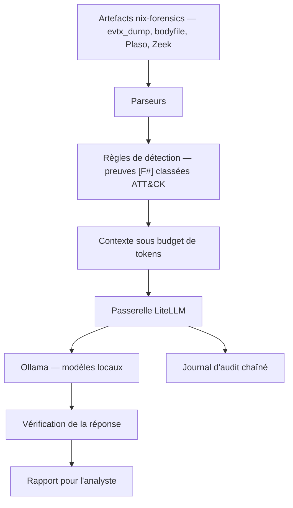

# Assistant LLM pour l'analyse forensique avec nix-forensics

L'assistant lit les sorties des outils de [nix-forensics](https://github.com/airbus-cert/nix-forensics), applique des règles de détection classées MITRE ATT&CK, puis demande à un modèle de langage un rapport d'incident, une réponse à une question de l'analyste ou une requête de chasse. Les modèles tournent en local derrière une passerelle LiteLLM : les données d'enquête ne quittent pas le poste ou le cluster. L'apport du modèle a été mesuré sur des scénarios annotés, en le comparant aux règles seules.

## Architecture

Construction en deux temps : tout ce qui peut être fait de façon exacte (lire les journaux, détecter, vérifier) est confié à du code déterministe. Le modèle ne fait que ce qu'aucune règle ne sait faire : relier les preuves, rédiger la synthèse, répondre en langage naturel.

| Module | Étape | Rôle |
|---|---|---|
| `parsers/` | 1. Lecture | Lit `evtx_dump` (JSONL ou `.evtx`), auth.log, bodyfile, Plaso `l2tcsv` et Zeek, et les ramène à un format d'événement commun |
| `detect/rules.py` | 2. Détection | 14 règles déterministes : chaque détection devient une preuve `[F1]`, `[F2]`… avec sa gravité et sa technique ATT&CK |
| `context.py` | 3. Contexte | Résume des milliers d'événements dans un budget de tokens : statistiques, preuves, chronologie des événements notables |
| `privacy.py`, `llm.py` | 4. Confidentialité | Dossier confidentiel par défaut, seuls les modèles locaux sont autorisés ; pour le cloud, pseudonymisation réversible des hôtes, comptes et IP |
| `assistant.py`, `prompts.py` | 5. Analyse | `summarize`, `ask` et `query` ; prompts versionnés |
| `assistant.py` | 6. Vérification | Schéma JSON, identifiants ATT&CK vérifiés, indicateurs cherchés dans les artefacts bruts, requêtes Sigma et jq validées puis exécutées |
| `audit.py` | 7. Traçabilité | Journal JSONL chaîné par SHA-256 : empreinte des artefacts, requête exacte, modèle servi, paramètres, réponse ; vérification et rejeu |
| `cli.py`, `tui.py` | Interface | Commande `dfa` et interface Textual |
| `eval/harness.py` | Évaluation | Compare chaque modèle aux règles seules : verdict, ATT&CK, indicateurs, questions, fuites, latence |

## Chaîne de traitement



Le serveur Ollama n'a pas d'accès à Internet, ni dans Docker Compose (réseau interne) ni dans Kubernetes (NetworkPolicies en default-deny). Un modèle cloud n'est utilisable qu'avec l'option `--cloud`, et uniquement sur un prompt pseudonymisé.

## Environnement

| Élément | Version | Fonction |
|---|---|---|
| Python | 3.11 et plus | Client `dfa` |
| LiteLLM | proxy, image `main-stable` | Passerelle compatible OpenAI, routage et alias des modèles |
| Ollama | 0.12.6 (Compose), 0.40.17 (Kaggle) | Exécution locale des modèles |
| Qwen2.5 Instruct | 14B et 7B | Modèles évalués (`dfir-local`, `dfir-local-small`) |
| Llama 3.2 | 3B | Modèle de secours sur un poste sans GPU |
| GPU | Tesla T4 (Kaggle) | Évaluation |
| Kubernetes | manifestes kustomize | Déploiement air-gapped et variante hybride |

## Évaluation

Trois jeux de scénarios annotés ont servi aux mesures :

| Jeu | Contenu | Rôle |
|---|---|---|
| `eval/scenarios` | 4 scénarios synthétiques : intrusion RDP, compromission SSH, balisage C2 et exfiltration DNS, journée normale | Valider la chaîne et mesurer les fausses alertes |
| `eval/public` | 8 enregistrements d'[EVTX-ATTACK-SAMPLES](https://github.com/sbousseaden/EVTX-ATTACK-SAMPLES) | Jeu de mise au point |
| `eval/holdout` | 10 autres enregistrements, choisis d'après leur nom et jamais utilisés pour écrire une règle | Mesurer la généralisation |

Taux de verdicts justes sur le jeu public, avec Qwen2.5 sur une T4, température 0 et graine fixe :

| Essai | Changement | Règles seules | 14B | 7B |
|---|---|---|---|---|
| 1 | Aucun | 62 % | 12 % | 25 % |
| 2 | Critères de verdict liés à la gravité des preuves, dans le prompt | 62 % | 62 % | 62 % |
| 3 | Nouvelles règles : spray Kerberos, PowerShell, faux compte machine, service lancé par un interpréteur | 100 % | 100 % | 100 % |

Au premier essai, les modèles repéraient bien les attaques mais répondaient « suspicious » au lieu de « malicious ». Les essais 2 et 3 ont corrigé les verdicts sans changer de modèle. Les règles ajoutées à l'essai 3 ont toutefois été écrites en regardant ce jeu : sur le jeu `holdout`, les règles seules ne donnent que **20 %** de verdicts justes et ne retrouvent la bonne technique que sur 2 enregistrements sur 10.

Sur le jeu synthétique, les modèles répondent mieux que les règles aux questions de l'analyste (75 % contre 62 %). Aucune fuite de donnée n'a été relevée. Deux sessions GPU distinctes ont donné des réponses identiques au token près pour les mêmes requêtes.

Les tableaux complets sont dans [`docs/results/`](docs/results/).

## Utilisation

```bash
git clone https://github.com/daren-houedanou/dfir-llm-assistant.git
cd dfir-llm-assistant
pip install -e '.[tui]'

dfa triage samples/win-rdp-intrusion                  # règles seules, sans modèle
```

Avec la passerelle et les modèles locaux :

```bash
cp deploy/.env.example deploy/.env                    # renseigner LITELLM_MASTER_KEY
docker compose -f deploy/docker-compose.yml up -d
export DFA_API_KEY=sk-change-me                       # même valeur que LITELLM_MASTER_KEY

dfa summarize samples/win-rdp-intrusion
dfa ask samples/linux-ssh-compromise -q "Quel compte a été compromis, et comment ?"
dfa query "connexions RDP externes suivies d'une création de compte" -t sigma
dfa tui samples/network-c2-exfil
dfa eval eval/scenarios -m dfir-local -m dfir-local-small -r rapport.md
dfa audit verify dfa-audit.jsonl
```

Dans un shell nix-forensics :

```bash
evtx_dump -o jsonl Security.evtx > Security.jsonl
dfa summarize Security.jsonl /var/log/auth.log
```

Sans GPU, le carnet [`notebooks/dfa-gpu-cloud.ipynb`](notebooks/dfa-gpu-cloud.ipynb) exécute la chaîne et l'évaluation sur Kaggle ou Colab. `DFA_BACKEND=mock` fait tourner toutes les commandes hors ligne avec un modèle factice.

## Portée et limites

- Le modèle est une aide à l'analyse, pas une preuve. Les constats d'un rapport doivent venir des règles et des artefacts, rejouables à l'identique ; chaque appel au modèle est journalisé et peut être rejoué.
- La détection repose sur 14 règles écrites à la main, qui généralisent mal (20 % sur le jeu `holdout`). La suite prévue est d'exécuter les règles [Sigma](https://github.com/SigmaHQ/sigma) de la communauté, via `sigma-cli` déjà présent dans nix-forensics.
- Avec les critères de verdict actuels, le modèle suit la gravité donnée par les règles et rattrape peu ce qu'elles ne voient pas.
- La pseudonymisation repose sur des expressions régulières et des champs connus : un nom de machine cité dans un texte libre peut lui échapper. L'envoi vers un modèle cloud reste donc une option explicite.
- Les scénarios synthétiques sont générés par `samples/generate.py`. Les données publiques ne sont pas redistribuées, elles sont téléchargées par `scripts/fetch_public_datasets.sh`.

## Documentation

| Document | Contenu |
|---|---|
| [Conception](docs/CONCEPTION.md) | Choix techniques, valeur probante (ISO/IEC 27037 et 27042), confidentialité, limites |
| [Kubernetes depuis Docker Compose](docs/KUBERNETES_FR.md) | Correspondance des objets et essai en local avec kind |
| [Résultats](docs/results/) | Tableaux de chaque essai d'évaluation |
| [Carnet GPU](notebooks/dfa-gpu-cloud.ipynb) | Exécution sur Kaggle ou Colab |

## Organisation du dépôt

- `src/dfirassist/` : code de l'assistant.
- `deploy/` : Docker Compose, configurations LiteLLM et manifestes Kubernetes.
- `eval/` : scénarios annotés (synthétiques, publics, jamais vus).
- `samples/` : artefacts synthétiques et leur générateur.
- `tests/` : 42 tests pytest, dont un test de l'interface sans écran et un proxy LiteLLM simulé pour l'intégration continue.
- `notebooks/` : exécution sur GPU.
- `flake.nix` : paquet Nix, shell de développement avec `evtx_dump` et overlay pour nix-forensics.

Licence Apache-2.0. Les données d'exemple sont fictives.
